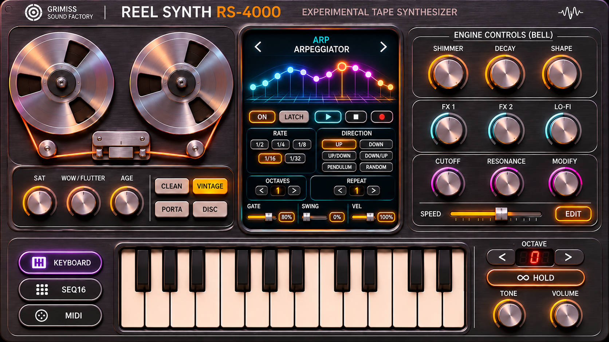
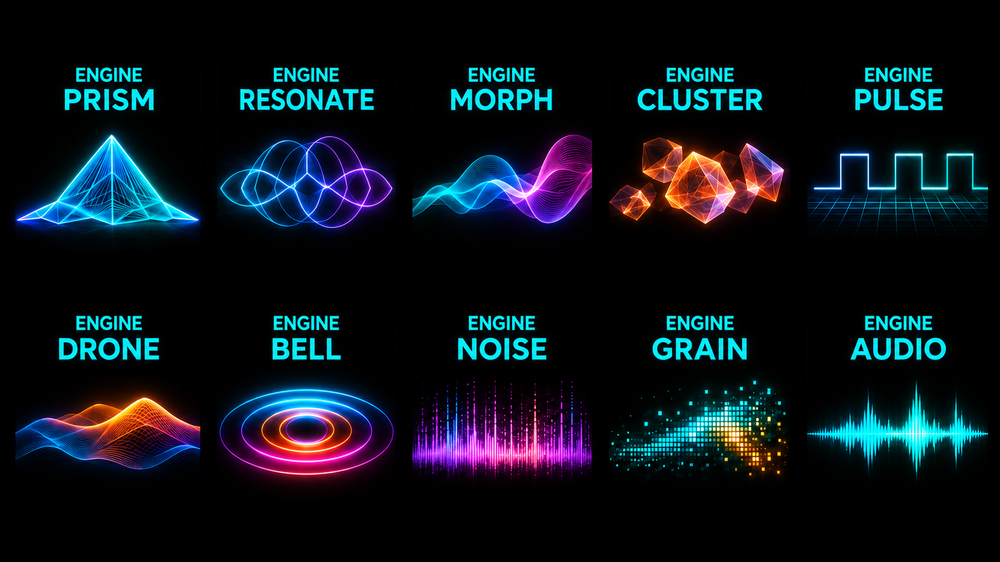
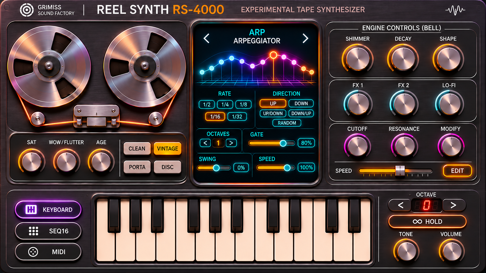

# GRIMISS RS-4000 — REEL SYNTH

**An experimental analogue-inspired synthesizer from Grimiss Ambient Sound Factory.**

## 1. Project Overview

The RS-4000 Reel Synth is a standalone, browser-based synthesizer designed for atmospheric, experimental and ambient sound creation.

The instrument combines vintage analogue-inspired synthesis, expressive modulation, an arpeggiator, and animated synthesizer engine displays within a distinctive hardware-inspired interface.

The RS-4000 will be developed using HTML, CSS, JavaScript and the Web Audio API, initially targeting desktop Google Chrome on Windows.

The finished application must be suitable for deployment through GitHub Pages and future integration into Grimiss Ambient Sound Factory.

Detailed sound-engine specifications, synthesizer functions and implementation requirements will be provided separately in the main Codex build prompt.

---

## 2. CRITICAL REQUIREMENT — VISUAL FIDELITY

**THE SUPPLIED REFERENCE IMAGES ARE THE DEFINITIVE VISUAL SPECIFICATIONS FOR THE RS-4000 REEL SYNTH.**

The primary design objective is to reproduce the supplied images as closely as technically possible in a fully functioning browser-based instrument.

**The images are NOT inspiration for an alternative design.**

Codex must not reinterpret, modernise, simplify, improve or redesign the supplied interfaces.

The finished synthesizer must look as close to the reference images as physically and technically achievable.

### 2.1 Non-Negotiable Design Rules

**1. Maximum visual accuracy**

Match the reference images as closely as possible, including:

- Overall dimensions and aspect ratio
- Section sizes and positions
- Knob and slider dimensions
- Button shapes and spacing
- Typography, lettering and label placement
- Panel colours and surface treatments
- Borders, outlines and corner radii
- Highlights, shadows and graphical details
- Visual alignment and spacing
- Distinctive hardware-inspired styling

**2. Preserve the exact layout**

Do not move, resize, remove, rename or reorganise controls, sections, displays, labels or other interface elements unless explicitly instructed.

**3. No creative substitutions**

Do not replace distinctive controls, displays, buttons, graphics or other visual elements with generic alternatives.

Standard HTML interface components must not be used where they would visibly compromise the reference design.

**4. No unsolicited redesign**

Do not alter the interface to follow conventional UI design principles, improve responsiveness, simplify implementation or make it look more modern.

The reference design takes precedence over Codex's own aesthetic preferences.

**5. Respect the original design dimensions**

Identify the actual pixel dimensions and aspect ratio of the reference images before implementation.

Use these as the authoritative basis for the synthesizer's visual canvas.

Preserve the proportions and relative positions of all elements.

If scaling is necessary for different screen sizes, scale the complete interface proportionally rather than independently rearranging individual sections.

**6. Preserve the visual character**

Carefully reproduce the hardware-inspired appearance, including subtle detailing, surface textures, panel treatments, highlights and deliberate imperfections.

Avoid excessively clean, generic or flat-looking substitutes.

**7. Functional controls without visual compromise**

Every control must be functional and interactive.

However, functionality must be implemented without unnecessarily changing its size, position, shape or visual appearance.

**8. No silent compromises**

If any element cannot be reproduced accurately, Codex must clearly explain the limitation rather than silently changing or replacing it.

---

## 3. DESIGN REFERENCE 1 — MAIN SYNTHESIZER

**Reference file:** `rs4000-main.png`

This image is the authoritative reference for the RS-4000's main synthesizer interface.

It defines:

- Overall instrument layout
- Panel dimensions and proportions
- Synthesizer sections and their positions
- Control types and placement
- Knobs, sliders, switches and buttons
- Section headings and labelling
- Colour scheme
- Typography
- Display areas
- Decorative elements and surface styling

### Implementation Requirements

The finished interface must reproduce this image as faithfully as possible.

Codex must measure the design geometry and implement the layout using appropriate HTML, CSS, SVG and/or Canvas techniques.

The actual graphical design must not be replaced with a simplified approximation.

The image itself must not be used as a static substitute for functional interface components.

Controls must be independently interactive while maintaining their correct visual appearance and positioning.

---

## 4. DESIGN REFERENCE 2 — SYNTH ENGINE ANIMATED GRAPHICS

**Reference file:** `rs4000-graphic.png`

### IMPORTANT — THESE ARE ANIMATION MOCK-UPS

This reference image contains static mock-ups of the intended animated synthesizer engine graphics.

**THE GRAPHICS MUST BE ANIMATED IN THE FINISHED INSTRUMENT.**

They must not remain static illustrations.

The mock-ups define how the graphics should LOOK, while the implementation must make them MOVE and respond to the synthesizer.

### Animation Requirements

- Reproduce the graphical designs as accurately as possible.
- Implement genuine real-time animation.
- Connect animations to relevant synthesizer parameters and engine activity.
- Reflect oscillator movement or signal characteristics where appropriate.
- Reflect modulation and LFO activity where appropriate.
- Reflect envelope behaviour where appropriate.
- Respond visually to filter settings and changes where appropriate.
- Respond to relevant user control adjustments.
- Maintain smooth and continuous animation.
- Preserve the reference image's graphical styling, colours, proportions and visual character.

### Technical Requirements

Use Canvas, SVG or another appropriate browser rendering approach.

Animation should use efficient rendering methods such as `requestAnimationFrame`.

Audio processing and visual rendering must remain separate.

Audio timing must remain authoritative.

Animation must not interrupt audio playback or introduce instability.

Where possible, display movement should be driven by real engine state rather than unrelated decorative movement.

### Visual Fidelity

The animation implementation must preserve the appearance of the supplied mock-ups.

Do not replace these designs with generic oscilloscopes, spectrum analysers, waveform displays or other unrelated graphics unless explicitly specified.

**These animated graphics are a core feature of the RS-4000, not optional decoration.**

---

## 5. DESIGN REFERENCE 3 — ARPEGGIATOR MODE

**Reference file:** `rs4000-arp-mode.png`

This image is the authoritative visual specification for the RS-4000's arpeggiator-mode interface.

### Implementation Requirements

- Reproduce the interface as accurately as technically possible.
- Preserve the layout and positioning of its controls.
- Match the original graphics, typography, colours and proportions.
- Make the arpeggiator fully functional.
- Ensure its controls interact correctly with the synthesizer engine.
- Implement appropriate real-time visual feedback.
- Preserve the surrounding instrument layout when changing modes unless the reference explicitly requires otherwise.

Do not replace the supplied arpeggiator design with a generic sequencer or conventional arpeggiator interface.

Detailed arpeggiator functionality will be defined in the main Codex build prompt.

---

## 6. MANDATORY VISUAL VERIFICATION

**Visual accuracy must be measured and verified, not merely assumed.**

Codex must not consider the graphical implementation complete simply because all visible controls are present.

### 6.1 Inspect the Reference Images

Before implementing the interface:

1. Open and examine all three reference images.
2. Determine their actual pixel dimensions.
3. Identify the main synthesizer's design canvas.
4. Establish section boundaries and relative positions.
5. Identify control sizes, shapes and spacing.
6. Analyse colours, typography, borders and visual detailing.
7. Identify the graphical elements that require real-time animation.
8. Record any ambiguities or conflicting visual details.

Do not begin by inventing an approximate layout.

### 6.2 Establish a Measured Layout

Use the images to establish a consistent coordinate system for the interface.

Where practical, record:

- Section coordinates and dimensions
- Control centre positions
- Control sizes
- Label positions
- Spacing and alignment
- Display boundaries
- Main background and panel colours
- Typography sizes and weights

Use these measurements to guide the implementation.

Avoid arbitrary CSS dimensions that are unrelated to the reference geometry.

### 6.3 Screenshot Comparison

Once the initial graphical implementation is running:

1. Open the application in a browser.
2. Match the browser viewport to the reference design dimensions where possible.
3. Capture a screenshot of the implemented interface.
4. Compare that screenshot with the original reference image.
5. Identify differences in layout, proportions, spacing, colours and visual styling.
6. Correct those discrepancies.
7. Repeat the comparison and correction process.

Use image overlays or visual-difference techniques where available.

The comparison process must include the main synthesizer and arpeggiator mode.

The animated graphics must also be checked against their static visual reference while verifying that their animation behaviour works correctly.

If browser screenshot tools are unavailable, Codex must clearly report this limitation rather than claiming visual verification has been completed.

### 6.4 Visual Acceptance Criteria

The interface must not be considered visually complete until:

- All major sections match the reference positions and proportions.
- Controls are correctly positioned and sized.
- Typography and labels closely match the designs.
- Colour differences have been minimised.
- Borders, outlines and panel detailing have been reproduced.
- Main synthesizer and arpeggiator layouts have been checked.
- The animated engine displays accurately reflect their reference graphics.
- No unexplained layout changes or generic substitutions remain.
- Any unavoidable discrepancies have been documented.

**Functional completion does not equal visual approval.**

---

## 7. SYNTHESIZER AUDIO ENGINE

The RS-4000 must contain a fully functioning real-time synthesizer engine.

It must not be a visual demonstration with placeholder sounds.

### Development Principles

- Use genuine real-time audio synthesis.
- Implement oscillator, filter, envelope and modulation behaviour according to the main build specification.
- Prioritise musical, expressive analogue-style sound.
- Use appropriate interpolation and parameter smoothing.
- Prevent avoidable clicks, zipper noise and unwanted digital artefacts.
- Maintain stable performance during rapid parameter changes.
- Keep audio DSP separate from graphical rendering.
- Design the sound engine for modularity and maintainability.

The specific synthesis architecture, parameters and control behaviour will be defined in the main Codex build prompt.

Do not assume the RS-4000 should use the same synthesis architecture as MikroSEQ or other Sound Factory instruments.

---

## 8. USER INTERACTION AND CONTROL BEHAVIOUR

The finished interface must be a fully interactive musical instrument.

Requirements:

- All intended controls must respond to user interaction.
- Visual control positions must accurately reflect their current values.
- Parameter changes must affect the correct audio-engine functions.
- Controls must respond smoothly and predictably.
- Relevant animated graphics must respond to parameter changes.
- The arpeggiator must integrate correctly with the synthesis engine.
- Visual feedback must remain synchronised with the underlying application state.

Do not implement controls that merely appear to work without changing their intended function.

---

## 9. APPLICATION ARCHITECTURE

The RS-4000 will initially be developed as a standalone browser application.

### Technology

- HTML5
- CSS3
- JavaScript
- Web Audio API
- AudioWorklets where technically appropriate
- Canvas or SVG for animated graphical displays

### Architecture Principles

- Keep synthesis DSP modular.
- Separate audio processing, interface state and graphics rendering.
- Use clear and maintainable code.
- Avoid unnecessary frameworks or dependencies.
- Preserve performance and stability.
- Allow future expansion without requiring complete rewrites.
- Maintain compatibility with GitHub Pages.
- Support eventual integration into Grimiss Ambient Sound Factory.

---

## 10. CODEX DEVELOPMENT WORKFLOW

Codex must use the following working principles:

1. Read this README and `AGENTS.md`.
2. Inspect all three reference images.
3. Read the main build specification in full.
4. Identify any major technical or visual conflicts.
5. Plan implementation in logical, grouped stages.
6. Preserve the supplied visual design throughout development.
7. Implement functional features rather than placeholders.
8. Test major functionality before reporting completion.
9. Carry out screenshot comparisons when supported by the environment.
10. Correct visual discrepancies before declaring the interface finished.
11. Keep code modular and maintainable.
12. Avoid unrelated changes.
13. Document incomplete functionality and known limitations.
14. Provide clear implementation and testing summaries.

Where appropriate, related implementation tasks should be grouped together to avoid unnecessary fragmentation of development.

However, grouping tasks must not eliminate the required visual verification or functional testing.

---

## 11. DESIGN CHANGE CONTROL

**The reference designs are locked unless an explicit change is requested.**

Codex must not independently:

- Reposition sections
- Rearrange controls
- Change the colour palette
- Substitute different control styles
- Modify typography
- Simplify decorative graphics
- Replace the animated display designs
- Redesign the arpeggiator interface
- Remove controls to save space
- Introduce a different overall layout

If a technical problem appears to require a design change, Codex must explain the issue and propose the smallest possible alteration.

Do not introduce that alteration without explicit approval.

Changes to audio-engine architecture are permitted when necessary to fulfil the approved build specification, provided they do not silently compromise the approved interface.

---

## 12. DEPLOYMENT

The finished application must run as a standalone browser-based synthesizer.

Initial deployment target: GitHub Pages.

Requirements:

- Support Chrome on Windows.
- Use GitHub Pages-compatible asset paths.
- Provide a working application entry point.
- Ensure the synthesis engine starts correctly following browser audio-unlock requirements.
- Avoid dependencies on local development services after deployment.
- Document any required setup or deployment procedures.

---

## 13. PROJECT PRIORITIES

The RS-4000 has two equally mandatory objectives:

**A. Visual fidelity:** Reproduce the supplied synthesizer designs as closely as technically possible.

**B. Functional fidelity:** Build a fully operational, musically expressive synthesizer whose controls, animations and audio engine work correctly.

Neither objective should be sacrificed to achieve the other without explicit approval.

The key project priorities are:

1. Maximum fidelity to the reference designs.
2. A genuine and musically expressive analogue-inspired synthesis engine.
3. Fully functional controls with accurate visual behaviour.
4. Real-time animated synthesizer engine graphics.
5. A fully operational arpeggiator.
6. Stable browser audio and efficient animation.
7. Clean architecture for ongoing development.
8. Compatibility with Grimiss Ambient Sound Factory.

---

## 14. PROJECT STATUS

**Initial development — reference designs supplied, implementation pending.**

The main Codex build specification will define detailed synthesis-engine behaviour, control mappings, arpeggiator functionality and other features.

The reference images and the visual-fidelity rules in this README remain authoritative throughout development.

---

## FINAL DESIGN DIRECTIVE

**DO NOT DESIGN AN RS-4000-INSPIRED SYNTHESIZER.**

**RECREATE THE RS-4000 SHOWN IN THE SUPPLIED REFERENCE IMAGES AS CLOSELY AS TECHNICALLY POSSIBLE, AND MAKE IT A FULLY FUNCTIONING MUSICAL INSTRUMENT.**

The original images must remain the visual standard against which all implementation work is evaluated.

**GRIMISS AMBIENT SOUND FACTORY**

*Experimental instruments for sound, texture and atmosphere.*
